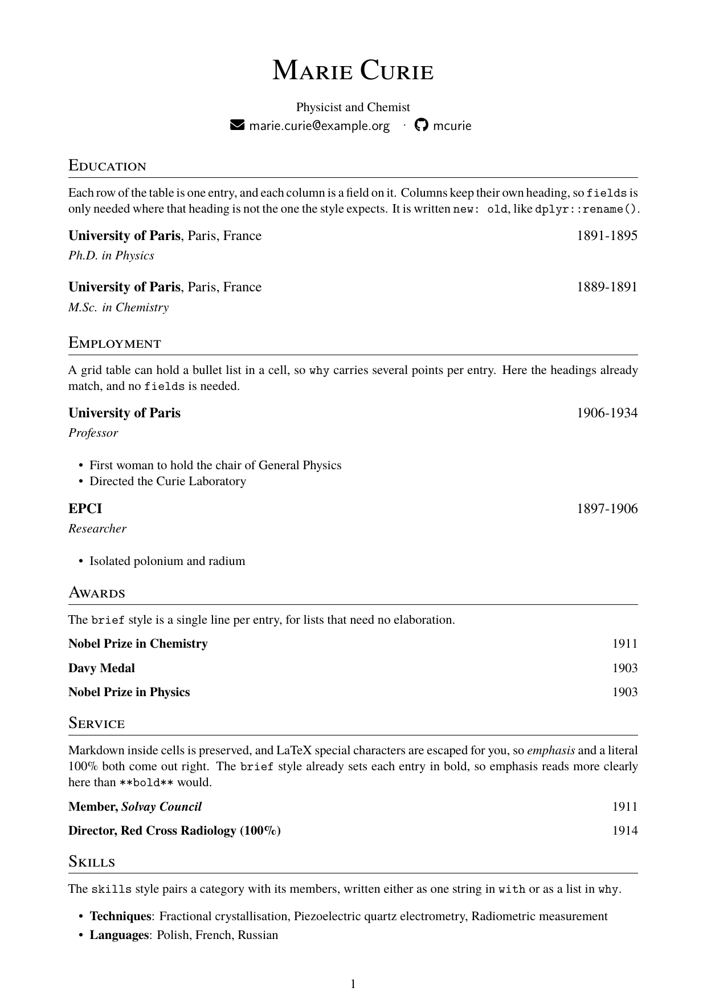

# Résumé

A Quarto format for writing a CV with [billryan/resume](https://github.com/billryan/resume),
an elegant XeLaTeX résumé template by Bin "Bill" Yuan, known for its
FontAwesome contact icons, small-caps section rules, and CJK/bilingual
support. CV entries are written as tables, either by hand or generated by
code.

<table>
<tr>
<td width="320"></td>
<td><code>format: billryan-pdf</code><br>A centred name and contact line over sections built from <code>.entries</code> tables, in the <code>detailed</code>, <code>brief</code> and <code>skills</code> styles.</td>
</tr>
</table>

## Installing

```bash
quarto use template quarto-vitae/billryan
```

This installs the extension and creates a starting `template.qmd`. To add the
format to a document you already have, use `quarto add quarto-vitae/billryan`.

Rendering needs a LaTeX installation with **xelatex**. If you have no LaTeX,
`quarto install tinytex` will do; the fonts are fetched on the first render.

## Using

Set the format and describe yourself in the YAML header:

```yaml
---
name: Marie
surname: Curie
position: "Physicist and Chemist"
email: "marie.curie@example.org"
github: mcurie
format: billryan-pdf
---
```

Write each section as a heading, and each listing as a table inside an
`.entries` div. One row becomes one entry, and one column becomes one field on
it, named by its heading:

```markdown
# Education

::: {.entries style="detailed"}
| what             | with                | when      | where         |
|------------------|---------------------|-----------|---------------|
| Ph.D. in Physics | University of Paris | 1891-1895 | Paris, France |
:::
```

Where your data uses different headings, rename them with `fields`, written
`new: old` in the manner of `dplyr::rename()`:

```markdown
::: {.entries style="detailed" fields="{what: Degree, with: Institution, when: Years}"}
```

Markdown inside table cells is preserved, so `**bold**`, `*italic*` and links
all work. LaTeX special characters are escaped for you exactly once, so a
literal `100%` needs no backslash.

### Entries from code

More often the data lives in a data frame, and the same options are given as
cell options. The cell prints a table and the filter picks it up:

````markdown
```{r}
#| echo: false
#| vitae:
#|   style: detailed
#|   fields:
#|     what: degree
#|     with: institution
#|     when: years
education |> filter(completed)
```
````

Entries can also come from a CSV printed by a cell, from several tables in one
div, or carry bullet lists written in grid table cells. Those are covered in the
[vitae documentation](https://quarto-vitae.github.io/).

## Styles

This format implements the three conventional vitae listing styles, mapped
onto upstream's own `\datedsubsection`, `\role` and `\datedline` macros.

`detailed`
: A subsection per entry: `with` (and `where`, if given) as the institution
  line, `what` as an italic role beneath it, and a bulleted elaboration built
  from `why`. Suits education and employment. This is the style used when
  none is given.

`brief`
: A single dated line per entry, from `what` set in bold and `with`. Suits
  awards, memberships and service, exactly as upstream's own
  Honors-and-Awards section. `where` is not shown; use the `detailed` style
  where a location matters.

`skills`
: A category in `what` paired with its members, given either as one string in
  `with` or as a list in `why`, as one bullet per category -- upstream's own
  plain Skills section.

## Format options

Set these in the YAML header. All are optional except `name`.

### Header contents

| Option | Effect |
|--------|--------|
| `name`, `surname` | The name shown in the header. Upstream's `\name` takes a single string, so `surname` (when given) is folded into it as `name surname`; write the whole thing in `name` if you would rather control the spacing yourself. |
| `position` | A subtitle under the name |
| `phone`, `email`, `www`, `github`, `linkedin` | Contact details, drawn with a FontAwesome icon each and separated by a centred dot, as upstream's own `\basicInfo` line does by hand |

### Appearance

| Option | Effect |
|--------|--------|
| `headcolor` | Accent colour as a hex string, such as `"8C1E1E"`, applied to each section's rule and to every entry's date. Upstream has no accent colour of its own, so this defaults to black -- a document that never sets it renders exactly as upstream does. |
| `fontsize` | Base font size, defaulting to `11pt`. |
| `papersize` | Paper size, defaulting to `a4`. Use `letter` for US letter. |
| `geometry` | Page margins, passed to the `geometry` package. |
| `linestretch` | Line spacing. |
| `colorlinks` | Set to `true` to colour links. Off by default, since this design marks links with an icon rather than colour. |

### Typography

Upstream sets TeX Gyre Termes as the body font (via four `.otf` files it
ships alongside the class) and Source Sans in the contact line, with
`\scshape` for the name and section headings. This port loads TeX Gyre
Termes by name instead, from the `tex-gyre` package every TeX installation
carries, so both can be replaced with any font installed on your system:

| Option | Effect |
|--------|--------|
| `mainfont` | Body font, used for entries, sections and the résumé's own headings |
| `mainfontoptions` | Font features passed to `fontspec`, such as `Numbers=OldStyle` |
| `sansfont` | Font for the contact line under the name, which upstream sets in `\sffamily` regardless of the body font |

```yaml
mainfont: "TeX Gyre Pagella"
sansfont: "TeX Gyre Heros"
```

### CJK / bilingual support

Upstream ships dedicated Simplified Chinese style files
(`zh_CN-Adobefonts_external.sty`) for a bilingual résumé. This port needs
none of that: setting `CJKmainfont` is standard Quarto pdf metadata, and
`font-settings.latex()` (called from `resume-preamble.tex`) wires up `xeCJK`
for it automatically, the same as it would for any other Quarto XeLaTeX
document.

```yaml
name: "Marie 玛丽·居里"
CJKmainfont: "Noto Serif CJK SC"
```

## Licensing

Released under CC BY-SA 4.0, see [LICENSE](LICENSE.md). Built on
[billryan/resume](https://github.com/billryan/resume) by Bin "Bill" Yuan,
released under the MIT license.

---

> [!TIP]
> **This is one of several vitae templates for Quarto.**
>
> They share the same entry syntax, so a CV written here can be rendered with a
> different design by changing the `format:` line. To browse the other
> templates, read the full guide to writing a CV, or build a template of your
> own, visit <https://quarto-vitae.github.io/>.
